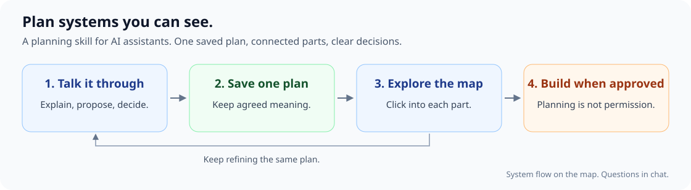
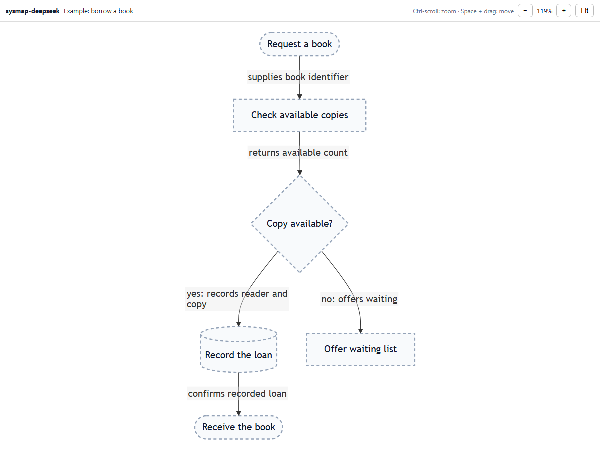
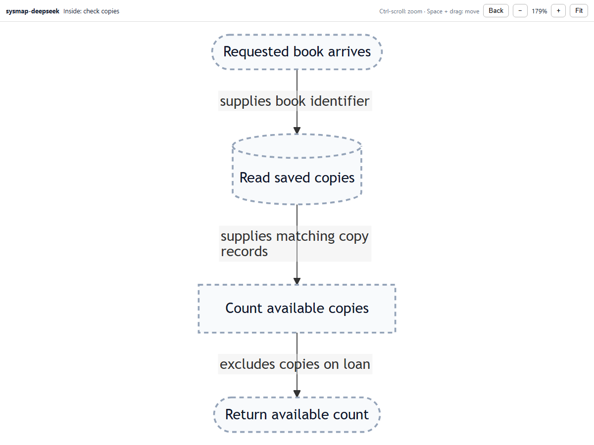

# sysmap-deepseek

**Visual system planning for DeepSeek Harness.**

Plan in chat. See the system on a map. Click a part to understand its job.

This is an independent community skill for **DeepSeek Harness**, not an official DeepSeek product or a skill package for other AI applications. Previously named sysmap.



[See it](#see-it-in-action) · [Install in DeepSeek Harness](#install-in-sysmap-deepseek-harness) · [Try the map](#try-the-map) · [Planning guide](references/planning.md)

## See it in action

### The whole system

The included example shows how borrowing a library book works. Follow the arrows from request to result.



### Inside one part

Click **Check available copies** to see only that part's work. **Back** returns to the whole system.



*Real screenshots of the included example. Dashed boxes represent a plan—not a built library service.*

## What it changes about planning

| Instead of… | The skill guides your assistant to… |
| --- | --- |
| Forgetting earlier decisions | Read and preserve one saved plan. |
| Asking endless small questions | Settle a point, then propose the next meaningful part. |
| Mixing unrelated work inside a box | Define its job, inputs, results, and boundaries. |
| Opening an unrelated detail page | Follow explicit page links, not matching letters. |
| Presenting suggestions as facts | Separate evidence, agreed plans, proposals, and unknowns. |
| Coding before planning is finished | Wait for separate implementation permission. |

Questions stay in DeepSeek Harness chat. The side map shows how the system works.

## Install in DeepSeek Harness

Requires DeepSeek Harness with filesystem skill discovery enabled. Install this repository as the `sysmap-deepseek` skill in your DSH home directory. The default is `~/.dsh/skills/sysmap-deepseek`.

For a default installation, run in PowerShell or a compatible shell:

```sh
git clone https://github.com/Pu11en/sysmap-deepseek.git "$HOME/.dsh/skills/sysmap-deepseek"
```

If you use a custom DSH home, place the repository in that home's `skills/sysmap-deepseek` directory instead. Keep the repository together: [SKILL.md](SKILL.md) loads [the planning guide](references/planning.md).

Then say in a DeepSeek Harness chat:

> Use the sysmap-deepseek skill to plan this system. Keep questions in chat, show the system on the map, and don't build it yet.

If the skill does not appear, check skill discovery or reopen the chat. Installation does not change every chat's instructions automatically. This repository is a skill and map helper, not a profile-wide add-on.

**Existing map setup?** Keep its current plan and viewer. These bundled helpers use explicit `detail` links and may have a different file format from an older setup. Do not replace your existing tools or plans just to install the skill.

## Try the map

The helper commands need **Node.js 20+** and a browser. No npm package installation is needed.

From the installed repository:

```sh
cd "$HOME/.dsh/skills/sysmap-deepseek"
node scripts/build.mjs examples/library.plan.json --out output
node scripts/serve.mjs --dir output --port 4322
```

Open **<http://127.0.0.1:4322/?map=library>** in the Harness side browser, or a browser tab. Port 4322 avoids the existing 4321 map setup used by some installations. Choose another free port if needed. Keep the server running; stop it with Ctrl+C.

The builder writes Mermaid text and navigation metadata. The browser loads **Mermaid 11.4.1 from jsDelivr** to draw the map. Internet access is required; this is not an offline viewer. The builder does not write SVG files.

| Control | Result |
| --- | --- |
| Click a linked box | Open its detail page. |
| Back | Return to the previous page. |
| Fit | Show the whole current page. |
| Ctrl + scroll | Zoom in or out. |
| Hold Space + left-drag | Grab and move the map. |
| Normal scroll | Pan vertically; horizontal wheel movement also pans. |

Each page opens fitted. There is no top row of step buttons.

## Keep one source plan

Use one uniquely named `.plan.json` source per planning conversation. Edit that source, not generated drawings. Preserve its decisions and rebuild after changes.

- **Flow:** parts, labeled connections, and detail pages.
- **Meaning:** each part's job, input, work, result, rules, and boundary.
- **Discussion:** agreed decisions, open questions, and the next planning topic.

See [the example](examples/library.plan.json) and [source format](references/planning.md#4-source-format-and-navigation). Detail links name exact pages; reusing a local box id does not connect pages.

Keep private plans out of version control. The helper server binds to localhost only. Do not expose it through a public tunnel. The viewer contacts jsDelivr for its drawing library.

## Checks and limits

```sh
npm test
```

Eight automated checks passed in the author's Windows environment. They cover plan validation, explicit navigation, generated output, server restrictions, and viewer script syntax. Headless Chrome rendered the screenshots above.

**Physical mouse behavior and real multi-turn planning remain unverified by those checks.** A successful render does not prove the system design is correct. The repository's tests do not certify DeepSeek Harness integration or every model's behavior. See actual GitHub Actions results for platform checks.

<details>
<summary>Reproduce the screenshots</summary>

Set `CHROME` to your Chrome or Chromium executable, then run:

```sh
node tests/browser-smoke.mjs
node scripts/capture-docs.mjs
```

Both need network access. These checks render the example; they do not simulate a complete planning conversation.

</details>

## License and sources

Original repository work is [MIT licensed](LICENSE). See [external software](THIRD_PARTY.md) and [planning sources](references/planning.md#sources). Not affiliated with or endorsed by DeepSeek or the referenced skill projects.
